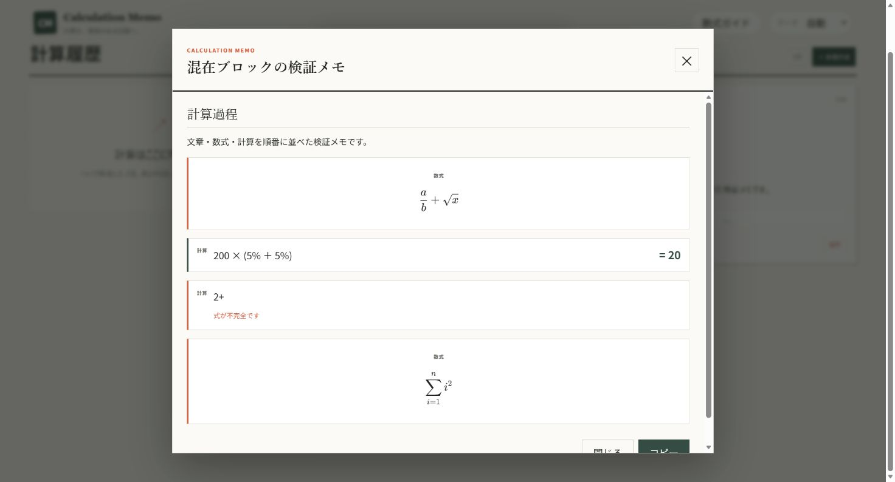
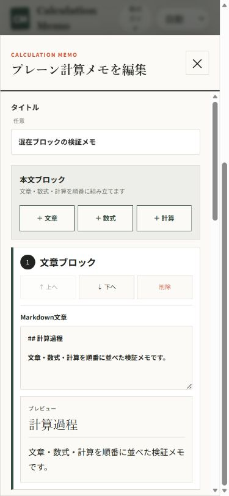
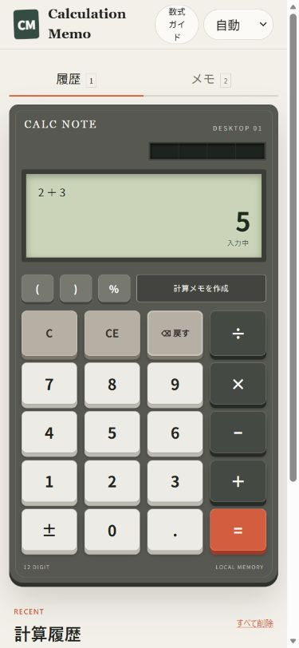

# Calculation Memo

卓上電卓のような操作感で計算し、式と結果を履歴や「計算メモ」として残せるWebアプリです。データは現在、利用しているブラウザ内だけに保存されます。

## 関連レポートの確認根拠

登録式の関連レポートから保存済み計算記録を安定したメモID・記録IDで関連付け、当時の式・実使用元/内部値・表示結果を読み取り専用で確認できます。明示確認保存では式定義と参照変数、確認日時、対象本文、選択根拠を履歴へ残します。式変更・未確認・情報不足を区別し、旧形式の欠けた日時は補いません。確認は利用者の操作履歴であり、数学的証明ではありません。

閲覧や切替は再計算・保存を行いません。根拠欠落/破損は参照不能と示します。リンク/確認履歴は各20件、既存レポート全体1MBの制限内で保持し、超過時に古い履歴を自動削除しません。操作・互換性・復旧は [確認根拠の設計](docs/agent/formula-report-evidence.md) を参照してください。

## レポート全体の根拠点検

関連レポートの「根拠点検」で、現在表示する本文の固定引用・比較差分を本文順に点検できます。編集中は未保存本文だけが対象です。「保存記録と照合」を押すまで未照合で、全項目に同じ取得時点の保存原本を使います。本文編集状態と出典の一致・変更・欠落・取得失敗・未知不正・関連付け解除を分け、詳細と対応本文へ進めます。

件数は認識できた本文上の出現数です。破損領域では集計不完全を表示し、0件や全出典一致を点検完了・数学的証明・利用者確認へ置き換えません。本文・関連付け・原本等が変わると点検結果や詳細を失効し、明示再照合を求めます。閲覧・絞り込み・照合・移動は保存や再計算を行わず、固定snapshot・確認履歴・保存形式を変えません。[保証範囲と設計](docs/agent/formula-report-audit.md) を参照してください。

## 主な機能

- 四則演算、小数、負数、括弧、符号反転、パーセントに対応した通常電卓
- 計算式と結果を同時に確認できる2段の液晶表示
- 正常に完了した計算の履歴保存、復元、コピー、削除
- 文章、数式、複数の計算式を組み合わせられる計算メモ
- 電卓の1つの式と結果を保存する単独計算メモ
- 単独計算メモの計算式・タイトル・メモを後から編集でき、式の変更時は保存時に結果を自動再計算
- 証明、計算過程、解説、和算、複数式をMarkdownで自由に記録
- 文章、表示専用のKaTeX数式、評価可能な計算式を混在できる本文ブロック
- 各ブロックの追加、編集、削除、上下移動と、複数ブロックの保存・復元
- Markdown本文内のインライン数式（`$...$`）と独立した数式（`$$...$$`）をKaTeXで表示
- 検索、コピー、編集中の入力欄への挿入ができる数式ガイド
- ライト／ダークテーマ、キーボード操作、レスポンシブ表示

## 数学レポートの章整理

編集画面から6章の説明付きテンプレートを本文末尾へ追加できます。既存本文は保持し、直後は専用ボタンで取消可能です。章名・順序・内容は自由に編集できます。折りたたみ式の章一覧から編集行やプレビュー見出しへ移動できます。操作だけでは保存・確認・再計算しません。[方式・解析範囲・Undoと保存保護](docs/agent/report-template-navigation.md)。

## 根拠点検結果の固定記録

根拠点検の「レポートへ挿入」から対象本文・対象ID・出力日時と原本取得日時・全件Markdownを確認し、「固定記録を本文へ挿入」でカーソル位置へ追加できます。範囲選択中の文章も保持し、未保存本文だけを変更します。編集画面で位置を選んでから点検を開いてください。本文プレビュー表示中は末尾へ挿入します。保存・確認・再計算は別の明示操作です。

記録はその点検時点に固定され、原本の後日変更や再照合では自動更新されません。未照合・結果失効・現在の保存本文との一致未確認・不完全集計もその制約を記録します。固定記録内部を新しい根拠として二重計上しません。未知・破損領域は推測回復せず不完全と表示します。対象本文のSHA-256と文字数は識別補助で、本文復元・真正性・数学的証明・外部保存との原子的整合の保証ではありません。

本文/対象/取得世代/更新通知/位置変更後の古いプレビューは挿入できません。直後の「点検記録挿入を取り消す」は今回の領域だけを戻し、本文編集後は取消を拒否して新しい編集を保持します。容量超過を切り捨てません。[方式・互換性・保証範囲](docs/agent/formula-report-audit-record.md)。

## 計算根拠の固定引用

関連レポートに保存済みの根拠リンクから記録・ブロックを選び、式、当時の実使用元/内部値、表示/内部結果をMarkdownへ固定引用できます。プレビュー後にカーソル位置へ挿入し、選択文章は消しません。挿入直後のカーソル復帰が遅れた場合、後続の本文編集・選択・次操作を古い位置で上書きしません。直後の専用取消が可能です。記録全体の追跡情報も本文へ保持し、取得時点との変更・欠落・照合不能・本文編集を区別します。元記録を自動更新せず、数学的証明や確認済み判定とは別です。引用/閲覧だけでは保存・再計算・履歴追加しません。[方式・範囲・容量・互換性](docs/agent/formula-report-quotes.md)。

固定引用の状態から、同じメモIDの別の保存済み根拠記録を明示選択して比較できます。比較元は現在の原本ではなく引用時のsnapshotです。式・実使用元/内部値・結果・追加/削除を確認でき、元記録欠落時も検証可能なsnapshotを保持します。数学的正しさの自動判定や引用の差し替えは行いません。[比較対象・未照合・互換性](docs/agent/formula-quote-comparison.md)。

## 確認時の備考

関連レポートの明示確認時に、任意の複数行備考を500 UTF-16コード単位まで記録できます。備考は利用者の申告であり、客観的な変更理由や数学的正しさの保証ではありません。保存・読戻し成功時だけ新規確認履歴に結び付き、通常保存では記録しません。過去の備考は編集・削除せずタイムラインで閲覧できます。旧記録の未記録と新しい空欄を区別します。新しい備考付き原本は旧版で保護停止するため、ロールバック前に原本JSONを退避してください。[上限・保存・互換性と復旧](docs/agent/formula-confirmation-remarks.md)。

## 登録式詳細と確認履歴

登録式ライブラリで式を選択すると、保存済みの式・変数・関連レポート・根拠確認状態・確認履歴をまとめて閲覧できます。選択や閲覧だけでは保存・確認・再計算しません。未保存編集は原本表示と区別し、他タブ更新後は「根拠未照合」と表示して再取得を求めます。編集は既存の編集ボタンから明示的に開始します。保存済み本文のコピー・Markdown出力も利用できます。確認済みは数学的正しさの保証ではありません。[設計・状態分類・復旧](docs/agent/formula-detail.md)。

確認履歴は詳細内の縦型タイムラインで閲覧できます。記録された確認日時・識別情報・確認時内容と取得原本の相違を表示します。実際の変更日時や変更理由は記録がないため補完しません。過去の一致を現在の承認にはせず、更新検知後は再取得まで未照合です。[範囲・順序・制約](docs/agent/formula-confirmation-timeline.md)。

## 登録式の根拠状態一覧・絞り込み

登録式ライブラリの各項目に、保存済み原本に基づく「確認済み」「要再確認」「未確認」「根拠なし（レポート未登録）」「根拠未照合」「状態判定不能」を文字で表示します。5つの状態グループで絞り込み、同じ詳細画面からレポート・確認履歴を閲覧できます。絞り込み・選択・再取得は保存や再計算を行わず、保存順序も変更しません。

一覧と詳細は同じ検証済み原本を共有します。他タブ更新後は両方を未照合に下げ、明示的な再取得後に照合し直します。未保存の編集内容は根拠判定へ混ぜず、保存成功後に原本を再取得します。確認済みは数学的正しさの保証ではありません。[設計と保護境界](docs/agent/formula-status-list.md)。

## 登録式の関連数学レポート

登録式ライブラリの詳細から「レポートを作成」「関連レポートを閲覧・編集」を開き、証明・導出・適用条件・由緒・参考資料をMarkdownで記述できます。式の定義・実行入力とは別領域に、安定した登録式IDで1件ずつ保存します。数式は既存KaTeXでプレビューし、生HTMLや任意コードは実行しません。見出しテンプレートは空欄の編集支援だけで、証明や史実・文献の生成は行いません。

「レポートを保存」は内容だけを保存し、「現在の式に対する内容を確認して保存」は利用者の明示確認を記録します。開いた・計算成功しただけでは確認済みになりません。式文字列が変わると要確認、名前だけの変更は対応を維持します。本文・タイトル変更後は再確認が必要です。「確認済み」は説明対象との対応であり数学的同値性・証明の正しさ・出典の信頼性の保証ではありません。

削除した登録式のレポートは保全され、「登録式が見つからない関連レポート」から閲覧・編集・本文コピー・.md出力で救出できます。コピー/出力は現在表示中の未保存本文も含み、保存を伴いません。レポートは200件、タイトル120文字、本文100,000文字、全体UTF-8 JSON 1,000,000バイトまで。超過は切り捨てず停止します。未対応/不正な保存形式では全体の非破壊保護を維持します。

保存結果を読戻し確認してから成功を表示します。他タブ・式・レポート変更の競合では古い確認を確定せず、本文を保持して上書きを止めます。旧版へのロールバック前には原本JSONを退避し、新レポートを含むデータを旧版で上書きしないでください。[保存構造・操作・互換性・復旧](docs/agent/formula-reports.md)。Memo Nexus直接通信、PDF、自動証明検証、版管理は対象外です。

## 計算メモのMarkdownレポート

保存済みのブロック型計算メモを開き、「レポート出力」からMarkdownソース確認・全文コピー・.mdダウンロードを行えます。開いた時点のブラウザ保存原本だけを読み取り、再計算・保存・履歴更新はしません。未保存の編集と未反映の試算を除き、文章/数式/計算の順序、入力式、保存表示値と内部数値、依存関係のMermaid、診断を出力します。

直接参照の根拠情報として、参照元の本文位置・ID・保存式・現在の保存内部数値/表示値・結果状態を出します。旧変数の再代入は不確定候補を残し、未使用の保存参照対応は直接依存から区別します。「現在」はレポートを開いた時点の保存原本であり、計算時の使用値ではありません。根拠履歴のない計算時使用値は確認不能と明記し、照合署名や現在値から過去の入力を復元しません。依存関係図も計算履歴の証明ではありません。同じ参照元の長い式/表示値は再掲せず本文位置を案内し、生成結果が400万文字を超える場合は黙って切り詰めず停止します。

結果は保存署名と依存状態から確定/古い可能性/エラー/結果なし/状態不明を区別し、旧データを推測で確定しません。解説・証明・由緒・出典は未記入の追記欄で、AI生成や証明検証はありません。保護中の原本を修復・再保存したり、未知構造を黙って省略したりしません。レポートは未知付随フィールドを含む原本JSONの代替バックアップではありません。

図/数式は受取先のMermaid/LaTeX対応で表示が変わります。Memo Nexusは対応コードを確認した範囲に限り、まず通常本文へ手動貼付けて確認してください。独自calc記法は実行させず文字化します。Memo Nexusの.md取込にはjsonフェンスをニュースとして解釈する経路があり、完全互換・自動取込・同期は保証しません。ダウンロード表示はブラウザへの要求でありOS保存完了ではありません。[設計・安全境界・制約](docs/agent/markdown-report.md)。PDF/印刷/双方向連携はこの出力の対象外です。登録式に紐付く説明資料は別の「関連レポート」で管理します。

### 保存記録の影響経路図

保存済み2記録の「変更影響分析」から「変更影響を図でたどる」を開けます。前後別の実使用参照を表示し、結果ブロックと起点を選んで代表経路を太線表示・絞込みできます。詳細は当時の式・参照名・内部使用値・表示/内部結果を確認でき、現在の未保存編集・試算は含みません。複数の変更分類は独立したラベルです。代表経路は全経路や数値変化の原因の証明ではありません。

側切替はID選択を維持し、片側欠損を明記します。比較ペア変更・前後入替・再取得では図の選択をリセットします。描画上限と分析上限を区別し、図だけが失敗・超過しても既存一覧と生成できたMarkdownを保持します。図の絞込みはMarkdownを削りません。[操作・保証範囲・検証データ](docs/agent/saved-impact-graph.md)。

### 計算確定時の根拠記録

明示的な全体再計算または試算の「結果を反映」が全件成功した後、「保存する」が成功すると、実際に評価器が読んだ参照元ID・旧変数の直前成功定義・内部使用値・式・結果・本文順/実行順・日時を一括記録します。旧自動計算メモは保存時の既存評価が全件成功した場合に記録します。再計算だけでは未保存候補で、通常編集・失敗・取消は履歴を増やしません。同じ式を繰り返し再計算すると別記録になり、保存済みの記録は参照元変更やブロック削除後も残ります。

過去の履歴がないデータに使用値を後付けしません。保存済みの現在値、当時の実使用内部値、表示丸め値は別物です。内部値は負のゼロも保持する文字列で記録します。レポートは履歴を独立章で出力し、「保存記録を再現検証」を押した場合だけ既存評価器で記録の参照元・使用値・順序・結果を照合します。通常の全文確認・コピー・ダウンロードは再計算しません。一致はJSONの真正性や数学的証明を保証しません。

履歴上限はメモあたり100回・UTF-8 JSON 500,000バイトです。超える追加保存は停止し、履歴を黙って削除しません。原本JSONを退避し、必要なら別メモで続けてください。保存失敗時は編集内容を保持し、成功と表示しません。他タブ更新は上書きを停止します。対応環境のWeb Locksで現行アプリ同士の書込みを直列化しますが、旧版・外部writer・非対応環境を含む完全な原子的排他や物理媒体への保存完了は保証しません。既存保存version1を維持し、未対応/不正な履歴は非破壊保護します。[根拠記録の設計](docs/agent/calculation-evidence.md)。 自動保存も共有ロックの待機中は未保存です。保存中の表示が消えてから再読込してください。未保存時は離脱警告を要求しますが、モバイルの強制終了・OS停止・警告を無視した離脱を防げる保証はありません。

## 計算ブロックの状態と診断

手動再計算のメモでは、変更元・影響候補・計算原因・参照先エラーを短いラベルで区別し、iボタンから説明・修正の手掛かり・対象ブロックへの移動を確認できます。旧結果は保持し、全体が成功するまで一括確定しません。保存後の再読込で変更前データがない場合は、以前の影響範囲を「不明」と明示します。依存関係と確認済みの状態をMermaid文字列としてコピーできます。[状態と診断の設計](docs/agent/calculation-status.md)。

## 試算・差分プレビュー

手動計算メモでは「試算する」で保持中の結果を変えずに新しい内部値・差分・変更元/影響・診断を確認できます。試算は未反映で、全件成功した場合だけ「結果を反映」で編集内容へ一括反映します。永続保存は従来どおり「保存する」です。入力や対象メモが変わると古い試算は失効し、反映直前にも入力と再評価結果を照合します。既存「メモ全体を再計算」は即時反映のまま維持します。旧自動メモは互換動作を変更せず、試算は手動メモだけに提供します。[試算・失効・保存境界の設計](docs/agent/calculation-trial.md)。

## 2種類の計算メモ

「計算メモ」は、文章ブロック、数式ブロック、計算ブロックを自由な順序で組み立てる正式なメモ種別です。文章ブロックはMarkdown、数式ブロックは表示専用のKaTeX、計算ブロックは通常電卓と同じ計算エンジンによる式と結果を保持します。ブロックごとに追加、編集、削除、上下移動ができ、不正な計算式はそのブロック内だけにエラー表示されます。

「単独計算メモ」は、電卓で確定した1つの計算式と結果を保存する従来機能です。編集画面では計算式、タイトル、前提・補足を変更できます。計算結果を直接編集する欄はなく、計算式を変更して保存すると同じ電卓ロジックで再計算されます。

本文はブロック構造に加えてMarkdown互換の`content`も保存するため、そのままコピーして別のMarkdown対応ツールへ受け渡せます。従来「プレーン計算メモ」と表示していた既存データも、本文を失わず正式な「計算メモ」として表示・編集できます。

### 画面







ASTは全体の許可構文検証後、検証済みの子の値を再利用して各ノードを一度だけ評価します。数値演算は既存mathjsを使用します。[互換性・性能の測定方法](docs/agent/ast-evaluation.md)。

## 基本数学関数

通常電卓、履歴、単独計算メモ、計算ブロックは同じmathjs 15.2.0の評価経路を使います。

| 入力 | 結果・規則 |
| --- | --- |
| `2^8` / `3^2+4^2` | 256 / 25 |
| `2^3^2` | 右結合の `2^(3^2)` = 512。`(2^3)^2` = 64 |
| `-2^2` / `(-2)^2` / `2^-2` | −4 / 4 / 0.25。累乗は単項負号より優先 |
| `sqrt(144)` / `sqrt(2)` | 12 / 約1.414213562373。引数は1つ、負数は実数エラー |
| `abs(-15)` / `abs(3-8)` | 15 / 5。引数は1つ |
| `pi` / `e` | 円周率 / 自然対数の底。小文字の定数だけで変数は不可 |
| `2*pi` / `e^2` | 約6.28318530718 / 約7.389056098931 |

### 入力・編集
- 電卓下部の「式を入力（累乗・sqrt・abs・pi・e）」を開き、式を入力/貼り付けて `=` または入力欄のEnterで計算します。通常キー配置は維持しています。入力欄変更は元式の置換・編集であり、旧確定結果/エラーを解除します。
- 単独計算メモの計算式欄、計算メモの計算ブロック、URL `expr`でも利用できます。LaTeXの数式ブロックは従来どおり表示専用です。通常のグローバルキー入力は `^` を追加し、英字関数名は式入力欄で入力します。関数パレットは未実装です。
- 確定後の `^` は内部数値から継続します。負の結果は括弧付きで引き継ぐので `1-4=−3 → ^2=` は9です。確定後の数字による新規開始と、BS/CE/±による元式編集は変わりません。
- CE/±は末尾の数値だけを扱います。`2^-3` のCEは `2^`、±は `2^3`。`sqrt(4)`・`pi`・`e`の末尾には数値エントリがないためCEは式を変えず、±は既存契約どおり `(-` を追記します（未完成式なので修正が必要）。関数/括弧全体の符号反転機能ではありません。式入力欄で `-sqrt(4)` 等へ直接編集できます。

### 安全性・精度・今回の制約
- mathjsの構文木を検証し、数値、`pi/e`、括弧、四則/単項±/累乗、1引数の `sqrt/abs` だけを許可します。代入、変数定義、任意関数、配列/オブジェクト/プロパティ、単位、条件式等は拒否します。eval/Functionを使う任意コード実行は追加しません。
- 新しい数学構文は明示的な `*` が必要です（`2pi` は不可、`2*pi` は可）。従来の数字・四則・括弧・%だけの式に限り、既存mathjsの `2(3+4)` 等の暗黙乗算を維持します。`e` の追加で科学記数法 `1e-7` / `2e3` を解禁しません。
- 正規化前2000文字以内、括弧/AST深度32以内、AST256ノード以内、各累乗の評価済み指数の絶対値10000以下です。全中間値は有限実数、最終絶対値は従来通り `Number.MAX_SAFE_INTEGER` 以下。`sqrt(-1)` や `2^1024`、途中のゼロ除算はエラーです。安全性のため、従来偶然評価できた `1/(1/0)` のような非有限中間値を含む式や、長大/過度に複雑な式は新たに拒否します。
- IEEE 754のnumber精度です。内部値・保存するresultは丸めず、表示のみ既存の桁区切り/最大小数12桁/指数表示を使います。任意精度や数学的な厳密値を保証しません。`0^0=1` はmathjsの既存数値規則です。
- 新しい関数・定数・累乗と `%` が同じ式に含まれる場合は明示エラーにします。数値・括弧式の後置%だけを対象とし、関数等との混在構文は引き続き制限します。ネスト括弧・先頭小数点%は[解析修正の設計](docs/agent/percent-parser.md)を参照してください。
- 保存形式/versionは変更しません。既存データを移行・削除せず、新式の履歴と両メモは同じ数値結果で再計算できます。ただし旧バージョンのアプリでは新構文を再計算できません。

## パーセントの仕様

`%`は、直前の数値または括弧式を100で割る単項演算として扱います。一般的な実機電卓にある「基準値に対する相対パーセント加算」ではありません。

```text
200 + 10% = 200.1
200 - 10% = 199.9
200 × 10% = 20
200 ÷ 10% = 2,000
10% = 0.1
```

表示、履歴、コピー結果でも同じ数式として扱われます。

ネストした `((50+50))%` と `(50+(25+25))%` は1、`(5%+5%)%` は0.001、`.5%` は0.005です。保存形式は変えず、通常電卓・URL・単独計算メモ・計算ブロックは共通の解析処理を使います。`50.%` のような未完の小数への%は従来どおり拒否します。連続%・暗黙乗算・空白の既存境界は[設計記録](docs/agent/percent-parser.md)に明記しています。

## 計算確定後とエラー後の入力

- BS・CE・±は上段に表示した元の式を編集します。編集すると確定結果を無効にし、再計算するまで単独計算メモを作れません。
- `12+3=15` の後、BS/CE→4→= は16、±→= は9になります。未編集で＋2→= は17になります。
- 確定後の数字・小数点・左括弧は新しい式を開始します。再度＝は同じ式を評価し、前の演算を繰り返す機能ではありません。
- エラー後の数字・小数点・左括弧は新規開始、BS・CE・±や演算子は失敗した式の訂正です。キーボードのBackspaceも同じ訂正、Delete/Escapeは全消去です。
- 履歴とURLからの式は従来どおり編集中として復元します。
- 小さい結果の継続演算も内部数値の精度を保ちます。表示値を丸めて再利用せず、編集可能な通常小数へ変換します。URL式の末尾空白・対応するUnicode符号も末尾数値の編集で扱います。
- 状態遷移と既存境界の詳細は[状態管理の調査記録](docs/agent/calculator-state-audit.md)を参照してください。ネスト括弧への%は[Issue #19の解析修正](docs/agent/percent-parser.md)として状態遷移とは分離して対応しました。

## URLから計算式を開く

URLの`expr`クエリパラメータを指定すると、起動時にデコードした文字列を電卓の計算入力へ設定できます。内容の確認前に自動計算や履歴保存は行いません。

```text
https://tetsujisugimori-coder.github.io/calculator-memo/?expr=2+*+%285+%2B+3%29
```

## データ保存

計算履歴、計算メモ、単独計算メモ、テーマ、最後に選択したパネルはブラウザの`localStorage`へ保存されます。アカウント同期やクラウド保存はありません。

保存データのトップレベルバージョンは従来どおり`1`です。表示名だけを整理し、`type: "plain-calculation"`はブロック型の「計算メモ」、`type: "calculation"`は従来の「単独計算メモ」として読み込みます。既存のtype値、単独計算メモ構造、ブロック型メモの`content`は変更していません。

ブラウザのサイトデータや`localStorage`を削除すると、保存した履歴と計算メモは失われる可能性があります。読み込めない保存データを検出した場合は自動保存を停止し、元データのコピーまたは確認付き初期化を選べます。

## 開発環境

Node.js `22.13.0`以上が必要です。

```bash
npm install
npm run dev
```

開発サーバーの表示に従い、通常は `http://localhost:3000` を開きます。

## 検証コマンド

```bash
npm test
npm run lint
npx tsc --noEmit
npm run build
```

## 今後の候補

以下は現時点では未実装です。

- 本格的な関数電卓パレット・三角/対数/階乗
- 関数電卓追加時の履歴・計算メモ領域のドロワー化
- 保存データの本格的なJSON書き出し・復元
- Memo Nexusへ計算結果を戻す双方向連携
- 複数端末同期

## 開発運用と履歴

エージェントの作業規則と PR 作成前の確認は [AGENTS.md](AGENTS.md)、開発履歴・重要な設計判断は [LOG.md](LOG.md)、PR の GUI 検証手順は [e2e/README.md](e2e/README.md) を参照してください。[GitHub 開発運用](docs/agent/github-workflow.md) と [検証方針](docs/agent/verification-policy.md) が Issue・PR・レビュー・CI の手順を定めます。各 PR では原則 LOG.md を更新し、不要な場合は PR 本文に理由を記載します。

### モバイル GUI 自動検証

PR の GUI 検証は Chromium の1365px・390pxマウス条件および390px・375px mobile/touch、WebKit の390px・375px mobile/touchを対象にします。数字・編集・連続計算・異常系復帰・履歴・両メモの保存と再読込を同じ期待値で確認し、タッチイベントと横方向のはみ出しも検査します。ヘッダーの一行ラベル・上端・非重複・操作領域、数式ガイドの検索/分類/開閉、テーマの切替/再読込も確認します。結果と画像・trace・対象SHAは [GUI手順](e2e/README.md) を参照してください。

WebKit自動操作はiPhone Safari実機の成功を意味しません。実機のソフトキーボード、Safari UI、セーフエリア、画面回転、長期保存などは別途確認が必要です。

### 計算ノートの変数

「＋ 旧変数計算」で追加した計算ブロックでは `price = 1200`、`quantity = 5`、`subtotal = price * quantity` のように名前付きの数値を使えます。変数は同じメモ内だけで有効で、上から順に評価します。再代入は後のブロックだけに反映され、失敗した再代入は以前の有効値を保持します。文章・数式ブロックは変数定義として実行しません。

名前は英字で始まる英数字・`_`（大文字小文字を区別）。既存関数・定数などの予約語は使用できません。変数モードでは掛け算は `*`、x/Xは変数です。既存ブロックは従来モードを維持し、警告付き「変数を使う」で明示的に切替できます。旧版アプリで新しい変数メモを再編集・再計算することは非対応です。

変数・式・結果は文字ラベルと背景色で区別します。通常電卓・単独計算メモ・URL受信には変数を追加していません。%と変数等の混在は未対応です。保存互換性、評価順序、安全制約と将来の表示設定への引継ぎは[変数設計](docs/agent/note-variables.md)を参照してください。

### 登録式ライブラリ（基礎）

電卓下の「登録式ライブラリ」で、名前と計算式を登録・一覧・選択・編集・削除できます。選択は詳細確認だけで、計算機・履歴・ノートの変数を変更しません。式は `price * quantity` のような値未設定の変数を含められます。参照変数は構文から抽出し、式と別のラベル・背景で表示します。代入は含めず、名前と計算方法を分離します。同名登録も可能でIDで区別します。

登録では構文だけを検査します。`1/0`、`sqrt(-1)`、`2^10001`等は登録できても計算できる保証はありません。入力長2000・AST深度32/256ノード・関数/演算の許可リストは既存変数エンジンと共通です。実行時の指数/有限実数/結果範囲制限は変更していません。数値や結果を仮置きして検査することはありません。

登録名120文字、式2000文字、200件まで。登録後の定義と選択は既存localStorage version1のoptional `formulaLibrary`（内側version1）に保存します。旧データはそのまま読めます。壊れた/未知versionのライブラリは元データを保護して自動保存を停止します。旧版アプリは新フィールドを保持しないため、新データを旧版アプリで編集しないでください。

編集は「登録する」で確定、「編集をキャンセル」で破棄。編集中は閉じる操作で入力を捨てず警告します。ただし未確定の編集内容はページ再読込では復元されません。削除は確認付き、直前1件はライブラリ画面を閉じるまで取り消せます。ブラウザの保存領域が使用できない場合は保存が保証されません。

### 登録式を実行する

登録式の詳細から「登録式を実行」を開くと、構文から抽出した変数の入力欄を表示します。符号付き十進数を入力し「計算する」で結果を確定します。変数の変更後は未確定へ戻り、再計算するまで履歴・メモへ渡せません。定義・登録式IDは変更せず、式内の同名変数を別の登録式の呼出しにはしません。

既存値は「初期値の取得元ノート」を明示選択して「ノートの変数を取り込む」で利用できます。そのノートを上から再評価した有効な変数を空欄だけに入れ、手入力・ノート本体・他ノートの値は変更しません。失敗した再代入は既存ノート仕様どおり直前の有効値を保持します。

入力途中の値（`-` なども含む）は登録式IDごとに既存localStorageのoptional `formulaExecutions`へ保存します。再読込・画面再オープン時は入力だけを復元し、結果は未確定から再計算します。保存領域のエラー時は保存できない場合があります。式の定義変更時は確認を促し、削除後は実行できません。旧データはそのまま読め、不正な追加保存領域は元rawを保護して自動保存を止めます。

確定した計算は「履歴に追加」「単独計算メモを作成」から渡せます。許可済みASTの変数だけに丸め前の数値を組み込み、通常電卓でも内部値が完全一致することを再評価で確認します。履歴は元ID・式・入力値の実行時記録を持ち、メモ本文にも実行時記録を残します。後の定義変更・削除で既存履歴/メモの計算は変わりません。極小値などの展開で既存の長さ/深度制限を超える場合は結果を表示したまま受渡しだけを止めます。履歴・単独メモの表示は従来の通常電卓の丸め規則、実行画面は既存の変数計算表示規則を使うため、整数近傍などでは表示文字列が異なる場合がありますが内部値は保持します。

未入力、不正な十進数、ゼロ除算、非実数、非有限値、範囲超過はそれぞれ説明を表示します。科学記数法・単位換算・登録式間参照は対象外。関連レポートは実行フローと別の説明資料として管理します。 `%` と変数等の混在制限は維持します。数値だけの定義はネスト括弧・先頭小数点%にも対応します。詳細は[登録式実行設計](docs/agent/formula-execution.md)を参照してください。

### 変数・登録式の識別表示

電卓下の「識別表示」で「ラベル＋色」「色のみ」「識別表示なし」を選べます。未選択時だけ既存レイアウトの720px以下は色のみ、それより広い画面はラベル＋色です。手動選択は既存localStorageのsettings.identificationModeに保存され、幅変更でも固定されます。旧データの欠落・不正値は初期設定として読みます。

変数は青、登録式は紫、計算式は黄、結果は緑。色のみ・なしでも補助ラベルの読み上げ情報と入力欄の名前・エラー説明は残します。iボタンで違いと設定を確認できます。説明本文は`lib/identification-help.ts`に分離しました。

入力はnative input/textareaを維持し、コピー・貼付・カーソル・IMEを装飾で変更しません。変数モードの計算ブロックと登録式編集では、入力欄の下に構文検査済みの代入先/参照変数を表示します。数値・定数・関数名は変数にしません。不完全/不正な式は識別保留になり、値が未定義の場合は参照名と計算エラーを別々に示します。保存済み計算ブロックにも適用します。従来モード、通常電卓、単独メモ、文章、KaTeXは変数識別対象外です。

登録式の一覧・詳細・編集の名前を登録式として表示します。式内で登録名が一致しても呼出参照にはしません。式間参照は未実装なので、変数と登録式参照が混ざる式の強調表示は対象外です。式中の文字別装飾ではなく安全な別表示を採用しています。名称変更/削除は既存ID管理に追従します。表示設定だけで式・評価・丸め・コピー内容・保存された数値は変わりません。


## 読み込み・保存の保護
未知のメモ/ブロック、不正な構造、空/重複IDを検出した場合、元JSONを残して保存とメモ編集を停止します。保存全体が一つのキーなので、正常な別メモだけを編集することはできません。復旧表示に「このメモは保護されています」と保護理由を表示します。「保護の詳細・復旧方法」から説明を開き、「原本JSONをエクスポート」または「元データをコピー」で検出時の原本全体を退避し、修復後に再読み込みしてください。ファイル出力で文字情報を完全に保持できない場合は出力を拒否し、元データを変更しません。初期化は明示的な破棄確認後だけ行われます。正常な旧本文のみのメモ・空ブロック配列は従来どおり利用できます。[設計・制約・検証範囲](docs/agent/nondestructive-storage.md)。

## 計算ブロックのID参照（手動再計算）
新規の「＋ 計算」はID参照方式を標準とし、数値だけの式と、同じメモの前後任意の計算ブロックを選んだ参照式を使えます。既存ブロックはそのまま維持し、必要な場合だけ「参照モードに切替」で変更できます。GUIが `@{1}` とブロックIDの対応を保存するため、内部ID入力は不要です。参照するのは丸め前の内部値で、sqrtなどの関数の結果も同じ扱いです。

ID参照方式の計算を追加したメモは、参照先がない数値式だけでも手動再計算になります。「メモ全体を再計算」で依存元から計算し、全成功時だけ結果を一括確定します。編集中・保存後の旧値は「再計算待ち・旧結果」と表示します。無関係の空式/エラーも全体確定を停止します。参照先を削除しても別ブロックへ勝手に結び直しません。

旧変数モードの変数束縛は従来どおり上から順です。ID参照の配置順非依存とは別の規則です。新参照モードでは変数名を直接使わず、その変数を計算したブロックを選択してください。参照開始前の旧メモの動作は変わりません。最大128計算ブロック。別メモ参照・自動再計算・ブロック関数呼出し・Excel一覧は今後の範囲です。Mermaid図表示は下記の読み取り専用UIから利用できます。[設計と互換性](docs/agent/block-references.md)。

## 内部依存解析・Mermaid出力
ID参照と旧変数の実構文を使う読み取り専用APIを追加しました。変更前後から潜在的な影響範囲を求め、安全にエスケープしたMermaid文字列を生成します。計算・保存・自動再計算は実行しません。現在は既存コピーUIと、読み取り専用の図表示・ブロック移動UIから利用できます。

旧変数の代入成功を静的に保証しないため、再代入失敗時に残りうる先行定義を不確定候補として表示します。参照先が確定するID辺とは区別し、保存済み結果を成功証明には使いません。実行計画も同じ構造解析を利用し、確定ID辺と旧変数の逐次制約を分離します。独立ID計算はID順で決定的に実行します。全体stale/手動一括確定は変えません。[実行順序と互換性](docs/agent/execution-plan.md)。[API・設計・限界](docs/agent/dependency-analysis.md)。

### 依存関係の変更比較と試算
「変更前後・試算」で編集開始時または最後の一括確定時との参照差分を確認できます。＋追加・−削除・変更不明、変更元/影響対象/影響なしを識別し、有効な試算だけ数値変化あり・数値変化なし・数値比較不可を重ねます。影響対象でも値が同じ場合は影響なしとは扱いません。比較一覧で旧結果→試算を確認し、比較図のMermaidコピーも利用できます。全計算ブロックを削除しても比較基点に計算ブロックがあれば入口を維持し、「削除済み（変更前）」のノードと参照線を確認できます。削除ノードは過去の記録で移動・編集できません。現在と比較基点の両方に計算ブロックがなければ空の図は表示しません。図の操作は計算・反映・保存を行いません。[比較と試算連携の設計](docs/agent/dependency-comparison.md)。

### 依存関係の図と編集への移動
計算ブロックの編集画面で「依存関係の図を開く」から参照先→利用側の図を確認できます。ノードを選択すると対応するブロックへ移動・強調し、「選択ブロックの計算式を編集」で入力欄へ移れます。図の操作は再計算・保存を行いません。i詳細は既存の診断と共通です。大きな図はスクロール/拡縮でき、表示上限超過や描画失敗時はブロック一覧と既存Mermaidコピーを利用できます。式の長文はpreview表示し、全文は移動先で確認します。[設計と安全境界](docs/agent/dependency-graph-ui.md)を参照してください。

### 保存済み計算記録の一覧と2記録比較

ブロック型計算メモの保存済み詳細から「計算記録を開く」を選びます。記録一覧は計算日時・保存要求時刻・記録ID・計算ブロック数を示します。保存要求時刻は保存完了時刻ではありません。記録0件では過去使用値は確認不能、1件なら詳細のみ、2件以上なら追記順で最新2件を初期比較できます。日時の逆転で順序を推定せず、前後入替も可能です。

安定したブロックIDを使い、式・モード・実使用参照元・実使用内部値・表示/内部結果・本文/実行順を同時比較します。結果が同じでも式や参照元の変更を隠さず、表示が同じでも内部値の差や-0を保持します。追加／削除は比較対象の記録間だけの意味で、本文全体の編集履歴ではありません。詳細は当時の記録だけを使い、現在値から補完しません。

「これから反映する変更」を扱う試算比較とは別の、保存された過去同士の比較です。未保存draft・未反映試算・未保存候補は含みません。開いた時点の保存原本を固定し、他タブ更新では自動差替えせず通知します。明示的な再取得後、消えた選択は解除して説明します。再計算・記録追記・保存・日時変更は発生しません。

同じ取得内容の比較Markdownを全文確認・コピー・.mdダウンロードできます。内部数値は丸め表示と区別し、上限超過時は省略せず停止します。コピー失敗やdownload開始失敗を表示し、OS保存完了は保証しません。差分は因果関係や数学的証明・真正性の証明ではありません。未記録の説明は確認不能、未知項目は未比較です。Memo Nexus等へはMarkdownを手動受渡しする範囲で、直接送信・履歴整理・上限変更はありません。

[設計と保証範囲](docs/agent/calculation-evidence.md) / [実生成した比較Markdown例](docs/agent/evidence-comparison-example.md)。既存100記録／500,000 UTF-8 JSON bytesの保存上限・保存形式・非破壊保護は変更しません。

計算記録の選択肢「記録 N」は取得時点の追記順です。完全なID・計算日時・保存要求時刻・件数は一覧と選択記録の情報で確認できます。番号が再取得で変わっても、選択は記録IDに対応付けます。

### 保存記録の変更影響分析

保存済み2記録の比較で「変更影響分析」を展開すると、直接変更（保存項目の観測差分）、波及変更候補、結果差分、順序差分、判定不能を独立に確認できます。実使用値の差は利用者の直接編集を意味するとは限らず、依存経路は数値的な因果関係の証明ではありません。変更前と変更後の実使用参照元を別々に追跡し、複数の起点の代表経路を示します。全経路列挙ではなく、上限に達すると不完全である旨を表示します。

前後の式・参照元・内部使用値・表示/内部結果は同じ取得時点の記録だけを使います。現在の未保存編集・試算・現在依存図で補完せず、再計算や保存を行いません。比較Markdown全文にも分類・経路・根拠・限界を含み、コピー/.md出力を維持します。v1で記録できないエラー/結果なし・不正/未対応形式は比較不可として保護します。保存形式、100記録/500,000バイト上限は変更しません。[設計と保証範囲](docs/agent/saved-record-impact.md)。

### 固定引用から比較差分を本文へ

関連レポートの固定引用で「別の保存記録と比較」→比較先を明示選択→「差分をレポートに挿入」から、全文プレビュー後に観測差分を通常Markdownとして追加できます。引用時snapshot・元の引用は不変で、本文の選択文章も保持します。挿入と保存・確認は別操作です。直後の専用取消、古いプレビューの失効、文字/容量の上限保護を備えます。差分は数学的証明や変更原因の判定ではありません。[設計と保証範囲](docs/agent/formula-report-diff-insertion.md)を参照してください。

### 比較差分の出典を確認する

新しく挿入する比較差分は、引用時点の両保存記録と追跡 ID を Markdown 内に保持します。関連レポートの「比較差分の出典」から当時の比較、現在取得した出典の変更・欠落・取得失敗・未知形式を区別し、保存記録の詳細や明示的な現在比較へ進めます。本文編集と出典の状態は別に表示し、確認だけでは本文・原本・確認履歴を保存しません。

旧差分は情報不足を推測で補わず保持します。保存スキーマ・上限・確認条件は変更せず、容量超過は挿入を拒否します。これは出典の観測機能であり、数学的証明や真正性の保証ではありません。設計・制限は [比較差分の出典追跡](docs/agent/formula-report-diff-tracking.md) を参照してください。

比較差分の内部への挿入は厳密な開始・終了情報で保護します。未知・破損・入れ子で対応が不明になった範囲は本文末尾まで保守的に拒否し、自動修復しません。通常の完全な差分の直前・直後への挿入は維持します。


### 根拠点検結果の独立 Markdown

「根拠点検」画面の「点検結果をコピー」「点検結果を.md出力」は、絞り込みや選択中の詳細に関係なく、認識できた全出現を本文順に出力します。一覧・詳細と同じ判定と明示取得した原本世代を使い、出力のための再取得はしません。対象レポート/登録式、保存済みまたは編集中本文・未保存変更、出力日時と原本の観測取得日時（UTC、ISO 8601）を区別します。

本文の未保存編集と、タイトル・関連付けを含むレポート全体の未保存変更は別に記録します。別タブなどの保存領域更新後は、画面に保持した本文であることと「現在の保存本文との一致は未確認」を明記します。通知だけでは対象レポートの変更・削除とは断定しません。編集基準本文に対する未保存変更とは別の制約で、出典を明示再照合しても、点検を閉じて再表示しても解除しません。従来の props 差替え時だけの保証に加え、旧本文を保持して上書きを停止する実アプリ経路を対象にしています。

未照合・失効時はその状態を明記し、以前の成功判定や取得日時を有効な結果として持ち出しません。破損等で集計が不完全なら理由と不明範囲を記載します。認識件数や0件・全一致・出力成功は、すべての根拠の網羅、利用者確認、数学的正しさ・真正性の保証ではありません。

本文やsnapshotの全文は含まず、復元用ではありません。出力だけでは本文・原本・確認履歴を変更せず、保存・再計算・確認を行いません。既存の計算メモレポートとは別の出力です。コピー失敗時は読取専用全文欄から手動コピーできます。ファイル名のみ既存方針で安全化・短縮し、出力内のID・タイトルは省略しません。400万文字上限超過時は部分出力せず停止します。ダウンロードは要求成功であり、保存完了はブラウザ側で確認してください。[設計と保証範囲](docs/agent/formula-report-audit-export.md)。
