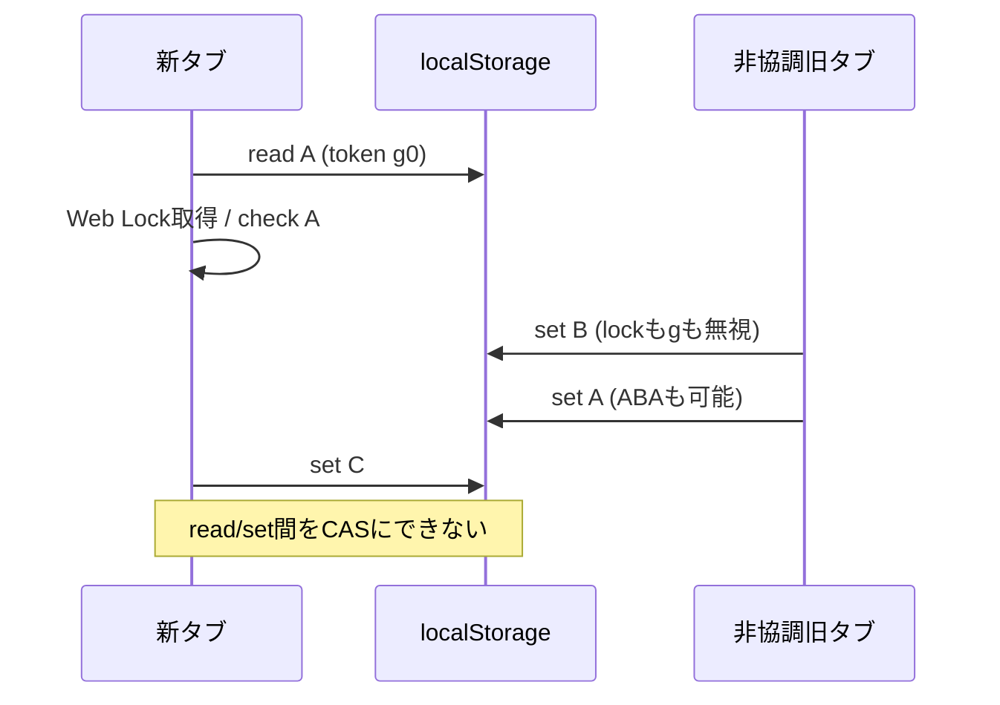
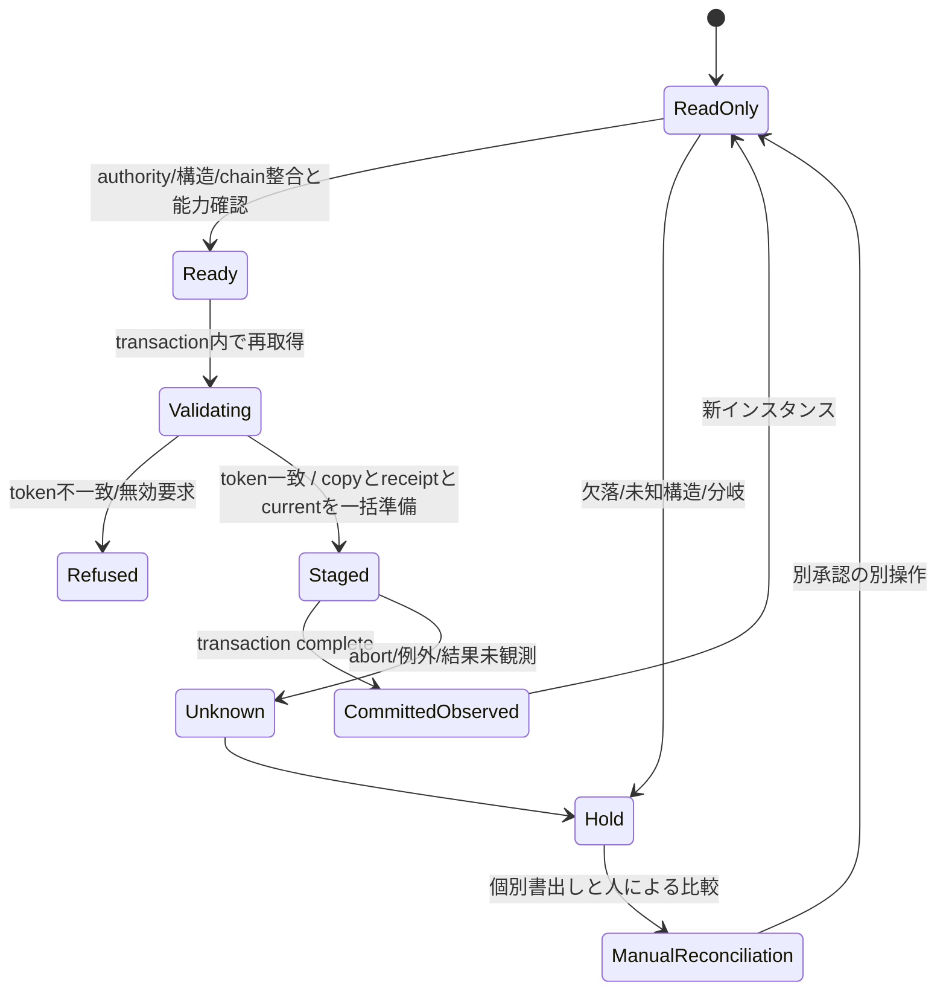

# Stage 3B-2: writer・旧タブ・世代管理の設計審査

2026-11-05 JST。Refs [Issue #124](https://github.com/tetsujisugimori-coder/calculator-memo/issues/124)、[#121](https://github.com/tetsujisugimori-coder/calculator-memo/issues/121)、前段 [#123](https://github.com/tetsujisugimori-coder/calculator-memo/pull/123)。
調査基点は最新main `120a265f539c0e6762f9eae6eedb52d8b922fbf6`。過去報告を保証の根拠にせず、現行呼出関係を読み直した。
本書・[writer台帳](storage-writers-stage3b2.md)・[検証台帳](../maintenance/storage-architecture-20261105/verification.md)を一組とする。

**総合PARTIAL。設計/試験専用PoC。製品writer/保存形式を変更せず、実選択復元の `executionAllowed=false`、Stage 3B HOLD、実保存許可NOを維持する。**
PoCのCOMMITTED_OBSERVEDは製品の保存成功ではない。実ユーザーデータ・移行・公開・マージは今回の対象外。

## 1. 現行コードからの訂正と保証の種類

現行 `lib/storage.ts:210` の `withStorageWriteLock` はPromise queueと `${STORAGE_KEY}:write` を使い、通常保存・全体復元・保全作成・保全削除の現在のUI呼出元が既に参加している。
「共通排他が全くない」とは結論しない。ただしWeb Locks不在時は通常/復元が同タブqueueだけで実行され、世代/UNKNOWN台帳はStage3B-1試験coordinatorと未統合。公開helper自体にロック強制はなく、旧コード/直接Storage操作には効かない。
`dataGeneration` はReact状態変更回数の揮発値であり、永続保存世代ではない。raw二度読取りもCASではない。

| 分類 | 本書での意味 | 例 |
| --- | --- | --- |
| 仕様上の境界 | APIが扱える範囲。実機/媒体保証とは別 | 同一DB・重なるscopeのreadwrite transaction、Web Locksの参加者間排他 |
| 実測 | 固定ソース/入力/engineの観測 | 2ページが同じtokenでIDBを更新し、一方拒否 |
| 合成 | 故障/順序を試験側が制御 | 世代だけ削除、履歴改変、通知subscriberなし、abort注入 |
| 設計仮定 | 次工程が満たす必要のある条件 | 全新writerが同じauthorityとtransactionを使用 |
| NOT_TESTED | 今回観測していない | OS電源断、実機Safari、自然発生の通知欠落・長期sleep |

参照日2026-11-05 JST: [HTML Web Storage](https://html.spec.whatwg.org/multipage/webstorage.html#the-localstorage-attribute) はagent cluster間のlockingを仮定しないよう求める。
[Web Locks仕様](https://www.w3.org/TR/web-locks/)のresource名は協調の契約で、Storage APIへのアクセス権限を変えない。
[IndexedDB 3.0 §2.7](https://www.w3.org/TR/IndexedDB-3/#transactions) のtransactionはscope内の条件付き更新をまとめる。`complete`とrequest成功は別で、durabilityはUAへのhintである。
[HTML Workers](https://html.spec.whatwg.org/multipage/workers.html#the-worker's-lifetime)の生存/共有条件を、全クライアントの永続的な単一writerとは同一視しない。
以下の採否はこれらと反例からの設計上の推論で、仕様が製品安全性を認定したという意味ではない。

## 2. 旧タブA–Jと競合モデル

同じoriginの旧タブは新方式のコードへ置換されない。アセット更新、通知、heartbeat、タブ列挙、Service Worker更新要求、「他タブを閉じてください」は強制失効の証明にならない。BFCache/長期sleepから旧JSが戻り得る前提を維持する。

| 条件 | 時系列/状態 | 結論・根拠と未検証 |
| --- | --- | --- |
| A 旧保存 | 旧タブがメモリsnapshot Xからsave | 旧writerを新側から止められない。固定原始Storage writerで実測、実旧bundleの全版実行はNOT_TESTED |
| B 新lock | 新タブが同名lockを所有 | 現行参加者間のみ有効。別名・不在API・別bucketでは同じ排他でない |
| C lock無視 | 新lock所有中に旧がsetItem | 実2ページで更新可能という反例を保持 |
| D 旧読取り | 新はA/g0を事前取得 | 読んだという事実だけでは書込み権限を得ない |
| E 検証後介入 | 新check(A)→旧set(B)→新set(C) | B消失。ページ間境界で制御したTOCTOU反例。既存helper内の瞬間をnativeで強制したとは言わない |
| F ABA | 旧A→B→A、世代を更新しない | raw一致でも変更履歴なしと判定不能。IDを増やしても旧が更新しなければ同じ |
| G 通知 | 変更通知を観測しないまま保存 | 通知を権限・CASにしない。subscriber不在を明示した実Storage反例/合成モデル。自然遅延/欠落の発生率はNOT_TESTED |
| H sleep再開 | staleなtokenを持つ旧/新再開 | 新協調writerはtransaction内token比較で拒否。旧writer停止は保証不可。長時間背景化実機はNOT_TESTED |
| I 新旧差異 | schema v1/新authority v2、異なるasset | capability不一致は新側で書込拒否。旧は旧LSへ書き続け、分岐データが発生。未知版を自動importしない |
| J 異常終了 | transaction前/途中/complete後/通知前 | 再読取の整合性・receiptと、利用者へのack・媒体永続化を分離。実page close/再openは実測、browser kill/電源断はNOT_TESTED |

Unknownは成功への自動遷移を持たない。再読取で一貫したcommit recordがあっても、元操作の「通知完了」を捏造しない。復旧操作IDは元UNKNOWNを消さない。

## 3. 世代・識別情報と永続記録

| 情報 | 採否・保存先 | 境界 |
| --- | --- | --- |
| structure version | 採用。authority envelopeに2、export payloadはv1の原文 | 旧readerに新保存先を触らせない。未知構造はHOLD |
| incarnation ID | 採用。新authorityを明示作成する際の一意ID | 全消失後に自動再生成して旧tokenを有効にしない。PoCは合成固定、製品は衝突対策が必要 |
| generation | 採用。非負safe integer、commitごと+1 | rawが同じでも増加。上限で拒否。単独では非協調ABA/初期化を検出不能 |
| operation ID | 採用。生成はtransaction前、再使用禁止、receiptと現tokenへ結合 | 複製/自動retryで再保存しない。PoCは要求ID、製品UUID生成/容量上限は次段階 |
| writer ID/protocol | 採用。build/protocol capability、許可範囲を検証 | 名乗るだけでアクセス制御にならない。PoCのwriterは非空labelのみ、実認証/配布制御なし |
| tab/instance ID | 採用。生存インスタンスごと異なる診断ID | 排他権限や永続leaseの代用にしない。sleep/再起動は新token取得 |
| writer generation | protocol versionとして採用、保存generationと分離 | 古いprotocolの新writerは拒否。旧LSコード自体は止められない |
| history/receipt | 採用。連続generation、previous operation、raw、writer/instance/kind | PoCは全chainを検査、自己整合性であって真正性/悪意ある同origin改変の防御ではない |
| preservation copy | 採用。同じtransactionにbefore token+完全原文 | 現行LS copyとの同時commitは不可。PoCは各commit前rawを保持 |
| ownership/expiry | IDB transactionを唯一のmutation境界にする | Web Locks/Workerは補助。時間ベースleaseを正当性の条件にしない。失効/停止後に別txで再比較 |

比較tupleは `(structure, incarnation, generation, latestOperation)`。generationの確認、candidate検証、copy準備、history追加、current更新は**同じreadwrite transaction**内。transactionの外で読んだ値を検査済みとして使わない。
PoC `tests/storage-architecture/poc.mjs` はIDB `vault/root`の一つのenvelopeに全要素を入れる。複数storeへ分けても全storeを同じscopeに含める必要がある。
全writer（通常保存/復元/削除/移行/修復）が守らないと条件は崩れる。PoCは製品schema検証器・履歴上限・承認UXを実装していない。

**PoCはtransaction coreの比較用であり、UNKNOWN後のruntime HOLD controllerは未実装。** `executionAllowed=false` / `HOLD=true` のexportと証拠値は試験範囲の宣言で、commit関数を止めるruntime gateではない。
abortは同transactionを戻すためUNKNOWN操作自体の永続intent/失敗recordは作られず、呼出元にUNKNOWNを返す。元tokenがまだ現行なら、別の明示commit呼出をこのcore単体は拒否しない。
complete後に外側で発生した例外も元failureをreceiptへ永続化する実装ではなく、writer labelの非空検査もprotocol/capability gateではない。
自動retryは実装していないが、UNKNOWNを覚えて通常writerも止めるcoordinator・別診断記録・protocol検証・UIは別途必要。上の状態図は完成済みPoCの全状態ではなく、推奨製品facadeの要求である。
Stage3B-1の保守的HOLD coordinatorとこのIDB coreを統合・受入したという主張はしない。

### 再起動と欠落

1. 起動時はread-only。chain/copy/current/structureを同時snapshotで読む。欠落・不整合はUNKNOWN/HOLD。
2. transaction abortを実際に観測した場合でもPoC呼出結果は保守的UNKNOWN。rootの旧状態が読めた事実と元通知失敗を別記する。
3. `complete`を当該instanceで観測して初めてCOMMITTED_OBSERVED。put request成功は不十分。complete後の例外/close/通知喪失も操作IDで照合する。
4. 新instanceのreceiptが整合していればCOMMIT_RECORD_OBSERVED、acknowledgement=UNKNOWN、durability=NOT_PROVEN。過去のUI ack/電源断耐性を判定しない。
5. generationのみ、historyの一部、copyのみ失われた場合は残存anchor/chainとの不一致を検知。全envelope消失は初回利用と区別できず、自動bootstrap禁止。
6. 整合した過去snapshot全体への巻戻しは内部chainだけでは検出不能。外部バックアップ/信頼できる別anchorとの照合が必要。LSの小markerも同時消失し得て完全な外部anchorではない。
7. quota/eviction/全IO不可/媒体破損では診断自体を残せない場合がある。ローカルコピーと原本は同じ障害domain。端末外exportは別行為で、ダウンロード要求は保存完了の証明でない。

## 4. 同一基準による方式比較

A=LS維持+共通coordinator/Web Locks/generation/ledger。B=IDB内にauthority/current/copy/receipt。
C=専用Worker/SharedWorker等への集約。D=LS v1 payload互換を残す段階移行（Bを保存先として採用する案）。
評価は実装案の比較であり全方式を製品で完成・実証したという意味ではない。

| 基準 | A localStorage維持 | B IndexedDB | C 単一writer | D 段階移行 |
| --- | --- | --- | --- | --- |
| 1 消失防止 | 協調排他+copyは有効、非協調TOCTOU残る | 同scopeでcopy/current/receipt一括。eviction/媒体損失は残る | backend依存、queue喪失あり | snapshot保管+片方向切替が必要、旧編集の救出別途 |
| 2 非協調writer | 旧setItemを阻止不可 | 旧LSはIDBを直接変更しないが旧側に分岐 | worker不参加writerを阻止不可 | 旧LSへ継続保存、排除を証明できない |
| 3 ABA | g参加者のみ、通知なし旧ABAは不可 | tx内tuple比較で協調ABA拒否、同origin任意改変/全巻戻し不可 | 永続gをbackendと原子更新しなければ不可 | LS側ABAを移行前後readだけで検出不可 |
| 4 原子性 | 複数キー/CASなし。単一envelopeでもread/set競合 | 同DB/scope/transaction内の比較と更新 | Workerという名称では原子性なし | LS→IDB跨ぎは非原子的。二重書込禁止 |
| 5 再起動整合 | intent/missing markerでUNKNOWN、全消失不可 | chain/receipt再読取。UI ack不明は別 | メモリqueue/leaseは消失、永続台帳必要 | authority状態/移行元hashと完全原文を保持、曖昧ならHOLD |
| 6 永続化失敗 | 部分順序混在/例外/全IO不能 | abortはtx全体、completeも媒体の無条件保証でない | backendで決まる、停止時結果不明 | copy/authority切替前後で失敗分岐を保存 |
| 7 保全copy | 別LS keyとcurrentは同時commit不能 | 同tx内copyがcurrent直前tokenと整合 | copyもbackendへ集約する必要 | 既存8slotは読取/個別exportを残し、新copyはIDB |
| 8 JSON互換 | 現行v1維持容易 | 内部envelopeからv1 rawを既存backup wrapperへ | backend次第 | v1 rawと既存backup/strict validationを維持 |
| 9 iPhone Safari | 既存APIだがsleep/eviction実機未確認 | engine検証と実機/private/quota/durability確認が必要 | SharedWorker対応/共有identity/停止を別審査 | 実機旧タブ/再開/upgrade-blocked受入必要 |
| 10 規模/保守 | 小〜中、強保証は得られない | 中〜大、全writer置換と容量設計必要 | 大、リーダー/通信/失効/再起動が増える | 大、read authorityと分岐救出のUX必要 |
| 11 拡張 | ledger/copy容量/同期UIで制約 | transaction/store設計は拡張可能 | 集約API利点はあるが複雑 | 後続schema分離に有利、互換窓管理が必要 |
| 12 人手復旧 | current/copy/candidateを別export | receipt照合でcommit有無を限定確認 | request IDとbackend照合必須 | 旧LS/新IDBを並列exportして明示選択 |

## 5. 推奨と移行の採用条件

**条件付き推奨: B（IDB authority）を保存の核とし、D（明示的・片方向移行）を別段階で組み合わせる。Cは性能/責務集約用の任意補助、Aは移行完了までの現行経路として保持する。**
理由は同一transaction内でtoken/current/copy/receiptを比較更新でき、IDBへアクセスしない旧LS writerによる新authorityの直接上書きを分離できるため。
旧タブが保存を続けても「全編集を無損失に自動統合できる」とは保証しない。任意の同originスクリプトはIDBも変更できるため、セキュリティ境界の獲得ではない。

移行案（今回は実装禁止）:

1. 現行LSを読み取り専用で取得し、元raw・backup・copyを端末外へ明示export。未保存編集を利用者が別保管。
2. 旧タブを閉じる案内をするが、閉鎖完了は証明扱いにしない。単に「開いているタブ数0」では受入不可。
3. 移行元原文とauthority manifestを新IDBの初回transactionに保存。LSを同時消去/新旧へ二重writeしない。前後LS照合で変化を観測したらHOLD。ABA未検出の限界は残る。
4. 明示承認されたsnapshotのみを新authorityとする。旧LSは凍結扱いの救出資料として残す。新コードは旧LSを自動再import/mergeせず、旧LS変更を観測したら分岐を表示し個別exportへ。
5. 移行後の新コード/全writerがIDBのみを読書き。LS markerは案内用であり権限の根拠にしない。旧タブへの警告通知はbest effort。
6. 失敗/blocked upgrade/不明authorityはread-only/HOLD。コピーや新authorityを自動rollback・削除しない。復旧は両側のrawとreceiptを人が比較した別承認操作。

採用条件: 全writer統合、永続状態/容量境界/保全削除のモデル、abort/complete/再起動照合、旧LS分岐救出、実機受入、独立レビュー。
旧タブ排除が必須要件なら同origin更新だけでは満たせない。新originへの移設/旧環境の明示隔離やアプリを閉じた管理された移行も候補だが、設定/公開/認証/データ移送を伴う別承認事項。今回採用・実施していない。

## 6. 必須10問への個別結論

| 問 | 判定 | 結論 |
| --- | --- | --- |
| 1 LS維持で必要な競合安全性 | CONFIRMED（否定反例） | 非協調writerを許す条件では達成不可。全協調だけなら条件付き改善 |
| 2 協調しない旧タブ | CONFIRMED（否定反例） | Web Locks/g/通知で排除不可。新IDB authority分離は旧編集の自動保全を意味しない |
| 3 IDB移行と旧タブ | PARTIAL | 片方向snapshot移行・旧側分岐救出。実製品移行/全旧版実行はNOT_TESTED |
| 4 再起動の正常とUNKNOWN | PARTIAL | receipt/chainでcommit recordの整合を限定観測、ack/媒体/全巻戻しはUNKNOWN |
| 5 履歴消失 | PARTIAL | 残存世代/copy/anchorとの不一致は検出。全消失/整合巻戻しは検出不能 |
| 6 保存先変更とcopy原子性 | PARTIAL | 同IDB同txなら可能、LS/端末外exportとの跨ぎは不可 |
| 7 JSON backup/restore | PARTIAL | v1 payload原文と既存wrapper/strict validatorを維持する設計。新製品adapter未実装 |
| 8 人手復旧削減 | PARTIAL | 一貫receipt照合で二重実行を避ける判断材料。UNKNOWNを勝手に成功化せず全消失は人手 |
| 9 通常/選択復元の共通モデル | PARTIAL | 同token+同txで競合拒否をPoC検証。製品writerは未変更、選択復元実保存NO |
| 10 次の最小構成 | PARTIAL | 全writer facade+read-only authority reader+IDB adapterの隔離受入から。移行/有効化は別審査 |

## 7. 次段階の最小実装と独立受入

| 優先 | 最小単位・依存 | 独立受入条件 |
| --- | --- | --- |
| P1-1 | 全writer facade（通常/explicit memo/report/reset/full restore/copy delete）、writer台帳が入力 | 全呼出元が列挙manifestと一致。Storage直接書込をbuild/static契約で検出。製品有効化はまだ別 |
| P1-2 | IDB adapter（P1-1）、tuple/current/copy/receipt一体、操作ID重複拒否 | 2ページ同token一方拒否、ABA/復旧競合、全put境界abort、request成功後abort、complete後通知喪失、再open。旧snapshot不変 |
| P1-3 | authority reader・UNKNOWN runtime HOLD controller・protocol gate・移行前read-only比較（P1-2） | coreがUNKNOWNを返した後の通常/復元も停止。別診断保存不能/abortでintent不在でも自動再試行0。欠落/未知版/chain破損/整合巻戻し限界、blocked/versionchange、全IO不可でも書込拒否 |
| P1-4 | 片方向の明示移行/旧側分岐救出（前3項と別承認） | 移行各境界停止、旧LS A→B→A、同時旧保存、新authority不変、両側個別export、人による選択、二重writeなし |
| P2-1 | 容量/履歴保持/compaction/保全削除（P1-2） | bounded quota、chain prune anchorの原子性、満杯拒否、copy削除が現/過去receiptと矛盾しない。PoC無限配列は製品不可 |
| P2-2 | 復旧UX・既存JSON互換（P1-3） | 旧backup corpusのbyte保存/strict validation、未知付加項目保持、元UNKNOWNと復旧別記、失敗後自動retry0 |
| P3 | 実機Safari/VoiceOver/private/background/長期保存、性能 | 合成アカウント/データで実端末の独立受入。WebKit engine成功を流用しない |

Stage3B-2で解決するのは、writer/旧タブの保証境界と採用条件の曖昧さ、および試験可能なtransactionモデル。上記P1の製品実装・P2の運用UX・P3の実機は未解決のまま。
今回の差分を戻す場合は新規PoC/runner/workflow/本書とLOG/README参照だけを不採用にでき、製品データ移行を戻す操作は不要。
