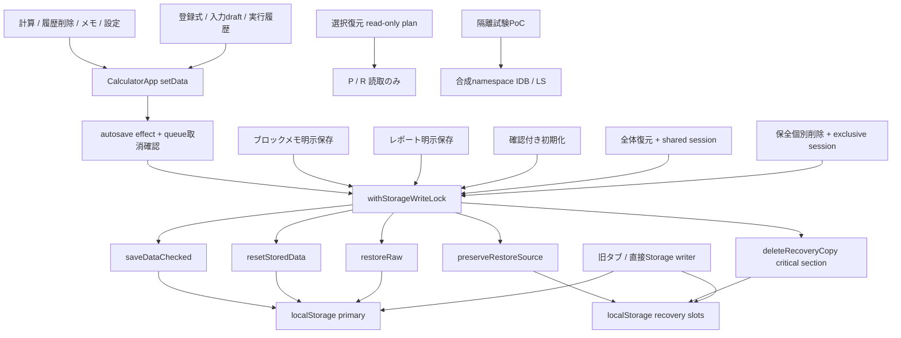

# Stage 3B-2 writer棚卸し

2026-11-05 JST、main `120a265f539c0e6762f9eae6eedb52d8b922fbf6` の追跡結果。
[設計/旧タブ/比較](storage-architecture-stage3b2.md)、[証拠台帳](../maintenance/storage-architecture-20261105/verification.md)。
`P`=`calculation-memo:data`、`R[i]`=`calculation-memo:restore-recovery:v1:0..7`。
永続writeのsinkは6関数（setItem5箇所/removeItem1箇所）。通常saveDataは現行appから未使用の公開helperで、潜在writerとして残す。
全てlocalStorage。製品にIndexedDB/Cache API/cookie/OPFS/FS/サーバーDB保存経路はない。

## 調査方法と網羅性の範囲

tracked全ファイル（727、開始時）を対象にStorage API・property assignment候補・永続API・DB・download/clipboardを検索し、sinkのimport/呼出元、`setData`からeffectまで、子componentのcallbackまで読んだ。
検索だけで完成としない。`app/page.tsx`→`CalculatorApp`、modalのprops→callback、libのpure mutator→React→effectを追跡した。
`db/`、`worker/`、`examples/`、scripts、tests、e2eも別分類した。`.agents/skills` はこのcheckoutには存在せず、root AGENTSとdocs/agent/e2e規則を参照。
未追跡の外部注入コード・ブラウザ拡張・任意旧bundleは調査済みソースの外。今後writer追加時は本台帳と静的境界検査を更新する。

## 製品sink（ロック/検証/失敗）

| ID・実装 | キー/開始条件・呼出元 | async・前後検証 | lock・世代 | 競合/失敗・依存・危険 |
| --- | --- | --- | --- | --- |
| S1 `lib/storage.ts:161 saveData` | P、helper呼出。現行app未使用、testsから使用 | sync、destination load/notes/candidate構造検証、readbackなし | helper自身なし、gなし | boolean false/catch。byte期待値なしで最新validデータ上書き可能。直接使用を将来禁止すべき |
| S2 `lib/storage.ts:192 saveDataChecked` | P、autosave/explicit memo/report | sync、expectedRaw二度照合、destination/candidate構造、set後完全raw一致 | caller L、永続gなし | conflict/invalid/unavailable/uncertain。最後read/set間非協調競合、ABA不可。set返却後にwritten=trueなので注入storageが変更後throwするとunavailable。native原子失敗の実証とは別 |
| S3 `lib/storage.ts:179 resetStoredData` | P、破損bannerの明示確認付き初期化 | sync、expectedRaw一致、default v1 set、readbackなし | caller L、gなし | boolean false。copy作成なし、TOCTOU/結果不明/新旧タブが残る。破損復旧はStage3B選択復元とは別 |
| S4 `lib/restore-storage.ts:35 preserveRestoreSource` | R[i]、全体復元の保全ボタン | sync、P原文・容量・既存8slot・同原文copy再使用・空slot二度、set後copy/P/valid照合 | caller L、session shared、g揮発valid | 失敗message、既存copy不変更/自動削除なし。slot最終確認/set間競合、Pとcopyの跨ぎ非原子 |
| S5 `lib/restore-storage.ts:64 restoreRaw` | P、全体復元の承認後実行 | sync、strict candidate/copy/P/valid、attempted=true→set、P/valid readback | caller L、session shared、g揮発valid | aborted/unknown/verified（観測だけ）。自動rollbackなし。非協調gap/通知なしABA、永続receiptなし |
| S6 `lib/recovery-manager.ts:92 deleteRecoveryCopy` | R[i] 1件、管理modalの明示承認 | async locks、critical section sync、snapshot全キー/P/target二度、remove後不在/他slot/P/承認 | recovery session exclusive ifAvailable＋L、g揮発valid | aborted/unknown/verified。UNKNOWNでcaller停止/通知。非協調remove/create race、媒体消去不可逆性、ledgerなし |

`L`= `lib/storage.ts:210 withStorageWriteLock`: module内Promise queue、navigator.locksがあれば`${P}:write`のexclusive request。通常/復元はAPI不在ならqueueのみ。helper単体はlock取得しない。
Recovery session=`calculation-memo:data:recovery-session`（`lib/recovery-manager.ts:8`）。全体復元はsharedを画面寿命中保持、削除はexclusive ifAvailable。Web Locks未対応では全体復元は既存fallbackでready=true、削除は拒否。両者は別の役割。

## 全ユーザー経路と間接writer

共通A: `CalculatorApp.tsx:150` effect→L→S2。readyかつconflict/restore/recovery/previewなし、queue開始時cancel/epoch/liveData一致。読み込み済clean rawは再直列化しない。
S2成功でsavedRaw/confirmed更新。conflict/uncertainはUI保存停止、invalidはloadしerrorなら保護、その他toast。lock rejectはconflict停止。
effectはReact更新後に非同期で走るため、ボタン表示/状態変更と保存完了は同一ではない。

| 経路/関数と根拠 | 対象・操作/開始条件 | sink・非同期/検証/依存と危険 |
| --- | --- | --- |
| W1 `CalculatorApp:210 calculate` | P.history、計算成功→先頭追加/最大200/2秒重複抑制 | setData→A。無効式は追加なし。式/結果のメモリ確定と永続化間に失敗可能 |
| W2 `CalculatorApp:337 requestDelete`、`:450 onClearAll` | P.history、削除確認後1件/全件 | setData→A。history「編集」は専用永続経路なし、restoreは入力変更だけ（下記） |
| W3 `CalculatorApp:243 saveNote`、`NoteModal onSave` | P.notes、単独計算メモ新規/編集、ready | setData→A、既存entry spread/時刻/ID。toastは保存処理中、競合はA側 |
| W4 `CalculatorApp:256 savePlainNote`、`PlainNoteModal` | P.notes、ブロックメモ新規/編集/計算根拠追記、明示保存 | async L→S2。originalの編集開始snapshot/liveData再確認、候補根拠を既存historyへappend。保存確認後のみReactへ反映、未確認draft保持 |
| W5 `CalculatorApp:337 requestDelete` | P.notes、単独/ブロック共通の確認削除 | setData→A。関連参照/既存report等は同じP全体が再保存、個別DB transactionではない |
| W6 `FormulaLibraryModal:39..55 submit`→`CalculatorApp:474 onChange` | P.formulaLibrary、登録式新規/編集、validateFormula/saveFormula | pure更新→setData→A、modal writable条件。式定義変更と履歴/根拠の関係は各pure validator、永続gなし |
| W7 `FormulaLibraryModal:92 removeFormula`、`:91 undo`→同onChange | P.formulaLibrary、確認削除/直前取消、選択ID変更を含む | setData→A。削除は関連reportを残す。取消は画面内removedを再登録、backend rollbackではない |
| W8 `FormulaExecutionModal:36 updateInputs`、`:74 ノート変数取込`→`CalculatorApp:475 onDraftChange` | P.formulaExecutions、各input変更/空欄への取込、formula/writable | setData→A、formulaIdで置換/既存定義にないdraft除外/最大200。入力イベント毎に候補、save完了前reloadで欠落可能 |
| W9 `FormulaExecutionModal:49 transfer(history)`→`CalculatorApp:475 onHistory` | P.history、確定実行結果の明示追加 | executionHistory→setData→A。transfer(memo)はeditorを開くのみ→W3 |
| W10 `CalculatorApp:299 persistFormulaReport`、`FormulaLibraryModal:90`→`FormulaReportModal onSave` | P.formulaReports、レポート作成/本文編集/quote/比較資料/確認・timeline等を明示保存 | async L→S2、保存原本load/raw/liveData照合、saveFormulaReportで生成。保存確認後のみReact反映。report単独削除APIは現行なし。report資料挿入/undoはdraft、保存時にこの経路 |
| W11 `CalculatorApp:345 setPanel`, `:346 setTheme`, `:457 IdentificationSettings` | P.settings.activePanel/theme/identificationMode、選択変更 | setData→A。全Pを保存するため他領域との競合も同じ。DOM dataset.theme更新は非永続 |
| W12 `CalculatorApp:134 startup timer` | P、loadがemptyの場合のdefault保存 | timer load→setData/ready→A。既存okの正規化はin-memory、clean guardで起動だけでは書かない。未知/破損はerror保護。自動migration/repairなし |
| W13 `CalculatorApp:365 resetStorage` | P、破損時の確認付き初期化 | async L→S3。成功後baseline/React更新、通常effectは同内容でwrite回避 |
| W14 `RestoreModal:76 preserve` | R、検証済file/current snapshot、session/valid/非busy | async L→S4、copyを確認表示、承認失効。file.textはwrite前async、tokenで旧結果を破棄 |
| W15 `RestoreModal:89 execute` | P、上記copy+明示承認+canApply/session/非terminal | async L→S5。verified後onApplied→`CalculatorApp:424 applyRestored`がbaseline更新。unknown/後続UI例外はonUncertainで停止。copyとP別操作 |
| W16 `RecoveryManagerModal:93 remove` | R、snapshot/key個別承認 | async S6。UNKNOWN→`CalculatorApp:419 protectUncertainRecovery`。RECOVERY_CHANGED_EVENTは定義/購読のみで、notifyRecoveryChangedの現行呼出元なし。削除後に同タブ通知が必ず発火するとは言えない |

全writerはP全体を扱うため、履歴/メモ/設定だけの操作でも兄弟領域を古いsnapshotで上書きし得る。共通raw比較は協調更新の競合を拒否するが非協調最終gapは閉じない。
現行UIの揮発generationは上記全setDataで増える。refresh/reload/別タブをまたぐ共有generationではない。startup/queue/storage通知/beforeunloadを横断して読んだ。

## 読取専用・揮発・外部出力（製品writerと区別）

| 対象 | 分類・根拠 |
| --- | --- |
| `SelectionPreviewModal`, `selection-preview`, `selective-restore-plan`, `selective-restore-safety` | Stage1/2/3A pure plan/preflight、getItem/二度読取り/focus/visibility/poll/epoch、executionAllowed:falseのみ。製品selective write sinkなし |
| `BackupModal`, `backup`, `storage-export`, `useFormulaSavedSnapshot`, `readRecoverySnapshot`, `readRecoveryCopies`, `exportRecoveryCopy` | getItem/parse/比較/JSON生成のみ。原文/未知領域を対象範囲で保持。exportは保存先データを変更しない |
| 履歴restore、URL式受信、式run、memo再計算preview、比較資料挿入/専用undo、ガイド/検索/選択/モーダル | メモリ/DOMのみ。保存操作を後で選べばW1/W3/W4/W10に到達。読み取り直しはwriterではない |
| `storage`/focus/visibility/RECOVERY_CHANGED_EVENT | invalidation/通知。自分のlocalStorage変更に自分へのstorage eventはない。書込authorityではない |
| beforeunload | 未保存警告だけ。unload自動保存はない |
| Blob/object URL/anchor download、navigator.clipboard.writeText | 利用者によるファイル/clipboard出力。ブラウザ内P/Rのwriterではない。OS保存完了は未保証 |

## その他の永続化候補と試験専用経路

| 対象 | 調査結果 |
| --- | --- |
| `db/index.ts getDb`, `db/schema.ts` | Cloudflare D1 facade/空schema。製品appから呼出なし、計算機データ保存なし |
| `examples/d1/app/api/notes/route.ts:50` | opt-inテンプレート例のPOST→Drizzle insert。examples以下で製品app routerに組込まれていない。D1 binding/既存認証/JSON validation/catch依存、共有ブラウザlock/gなし。実行/DB変更していない |
| `worker/index.ts` | vinext handlerと画像変換。DB mutation呼出なし。Service Worker/SharedWorker保存役ではない |
| scripts/config/Actions | benchmark一時ファイル・ビルド/証拠生成。実ブラウザデータのwriterではない。配信Pages workflowは今回は変更なし |
| tests | fake/localStorage/Storage API故障注入、Stage3B-1 coordinatorのledger/failure/test primary namespace。製品importなし |
| e2e | fresh contextのsynthetic fixture、他page直接set/remove/clearによる反例、runner fileログ。プロファイル/実originは使わない |
| Stage3B-2 PoC | `stage3b2-test-*` IDB vault/root transaction、同prefix LS/locks、Worker。製品からimportされない。任意rawは合成のみ。schema/容量未実装 |
| direct Storage | 製品set/removeはS1–S6のみ。製品clear・sessionStorage・indexedDB・cookie書込・Cache API・OPFSなし。global property代入/別名経路も候補検索し、上記への到達なし |

## 依存関係図

図のLockから分岐するsinkはcaller条件に従って選ばれる。削除では実際の関数S6が先にsession lock、その中でLを取得するため、図は依存概略であって再帰呼出を示さない。
