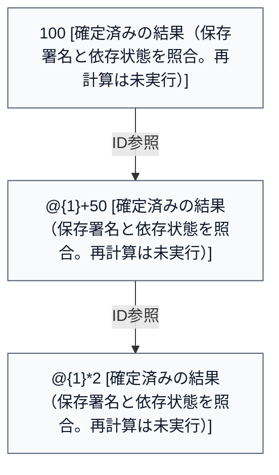

# 計算過程の記録例

## 基本情報

- メモID: example\-note
- 作成日時（保存記録）: 2026\-10\-21T00:00:00Z
- 更新日時（保存記録）: 2026\-10\-21T00:00:00Z

保存済み原本の読み取り専用レポートです。再計算はしていません。未保存の編集・未反映の試算は含みません。表示値と内部数値を区別し、数値の存在だけで正しさを保証しません。

## 本文・計算過程

### ブロック 1（文章）

ブロックID: intro

**前提**: 基本金額100に50を加え、その2倍を比較します。

### ブロック 2（計算）

ブロックID: A

入力式:

```text
100
```

状態: 確定済みの結果（保存署名と依存状態を照合。再計算は未実行）

保存表示値（丸め・整形済み）:

```text
100
```

保存内部数値: 100

評価方式: legacy（旧方式）


### ブロック 3（計算）

ブロックID: B

入力式:

```text
@{1}+50
```

状態: 確定済みの結果（保存署名と依存状態を照合。再計算は未実行）

保存表示値（丸め・整形済み）:

```text
150
```

保存内部数値: 150

評価方式: block\-references

- ID参照 @{1} → A（参照先あり）

### ブロック 4（計算）

ブロックID: C

入力式:

```text
@{1}*2
```

状態: 確定済みの結果（保存署名と依存状態を照合。再計算は未実行）

保存表示値（丸め・整形済み）:

```text
300
```

保存内部数値: 300

評価方式: block\-references

- ID参照 @{1} → B（参照先あり）

### ブロック 5（表示専用数式）

ブロックID: formula

$$
y = 2(x + 50)
$$

## 依存関係図

保存済み状態の図です。実線はID参照の確定依存、破線は旧変数の不確定候補です。辺は数値変化や計算成功を保証しません。Mermaid非対応の環境ではコードとして表示されます。



## 計算状態と注意事項

これは保存時の記録と静的な構造確認です。計算の成立と数学的な証明の成立は別です。旧方式など署名のない結果は状態不明としています。Markdownは原本JSONの代替バックアップではなく、未知の付随フィールドは解釈・掲載していません。


## 解説・根拠の追記欄

未記入: 数式の証明・導出過程、使用条件と前提、由緒・歴史、参考文献・出典を必要に応じて追記してください。このレポートはそれらを自動生成・検証していません。
